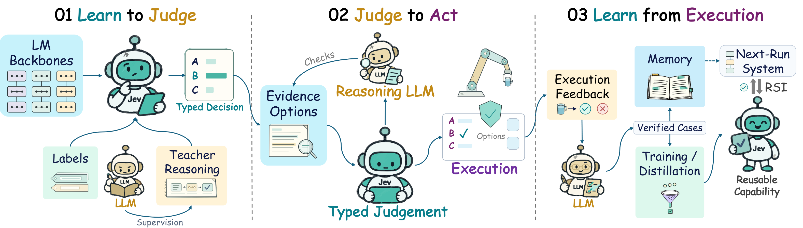
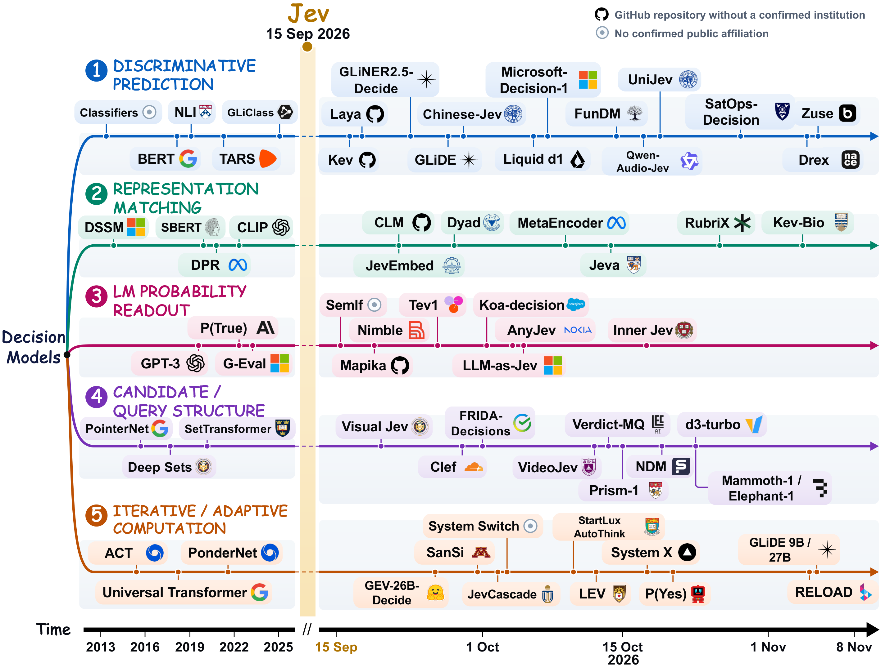

<div align="center">

<p>
<a href="assets/jev_teaser.pdf"></a>
</p>

# When Fast Decisions Meet Deliberate Reasoning: A Survey of Jev and Related Models

**Typed Decisions · Model Construction · Agentic Integration · Co-Evolution**

<p>


<a href="https://github.com/OmniAI-Lab-CUHKSZ/Jev_Survey/pulls"></a>
</p>

<p>
<a href="#evolution">Evolution</a> ·
<a href="#building-jev-models">Building Jev</a> ·
<a href="#datasets-and-benchmarks">Datasets &amp; Benchmarks</a> ·
<a href="#agentic-workflows">Agentic Workflows</a> ·
<a href="#domain-applications">Applications</a> ·
<a href="#future-directions">Future Directions</a> ·
<a href="#citation">Citation</a>
</p>

</div>

<a id="news"></a>

## 📰 News

- **[2026/11]** We release **Jev Survey**, a curated collection of papers, models, and benchmarks on Jev and typed decision models. The paper is **coming soon**.

---

<a id="introduction"></a>

## 📖 Introduction

Official repository for **When Fast Decisions Meet Deliberate Reasoning: A Survey of Jev and Related Models**.

LLM agents repeatedly judge which information matters, whether an intermediate result is reliable, and what to do next. Generating an extended response for every such judgment is costly when decisions are frequent or latency-sensitive. **Typed decision models** such as **Jev** offer an alternative: given evidence, a question, and a response type, they return bounded choices, scores, or probabilities that programs can consume directly, and they leave extended reasoning to the cases that need it.

This survey reviews commercial Jev, open Jev-like models, and their use in agent systems, covering work through **October 2026**. We organize mechanisms and operating conditions around **decision space**, **information state**, and **computation policy**, and distinguish **model-level fusion** from **system-level collaboration**. Our central observation is that a decision model is only as good as the evidence and alternatives it receives, and that collaboration pays off only when extra computation can actually correct its errors.

The figure above follows decision capabilities through three stages:

| Stage | What happens | Covered in |
| :--- | :--- | :--- |
| **01 Learn to Judge** | Pretrained backbones, labels, and teacher reasoning are turned into typed decisions. | [Building Jev Models](#building-jev-models) |
| **02 Judge to Act** | Typed judgments screen evidence and options, call on a reasoning LLM when needed, and drive execution. | [Agentic Workflows](#agentic-workflows) |
| **03 Learn from Execution** | Execution feedback flows into memory, training, and distillation, producing reusable capability and recursive self-improvement. | [Self-Improvement](#recursive-self-improvement) · [Future Directions](#future-directions) |

<a id="typed-decision-interface"></a>

## 🧩 Typed Decision Interface

A typed decision model answers a request $r=(s,q,\tau,\Gamma)$, where $s$ is the evidence state, $q$ the question, $\tau$ the response type, and $\Gamma$ the permitted answer space. Both $q$ and $\Gamma$ are supplied at inference time, so one model can serve many changing decision tasks through a common interface. Jev exposes three text primitives:

| Primitive | Question it answers | Output |
| :--- | :--- | :--- |
| `Choice` | Which of the supplied options should be taken? | A probability distribution over the candidate set |
| `Score` | Where does the case fall on an ordered scale? | A distribution over ordered rating levels |
| `Noul` | Is this proposition true? | The probability that the proposition holds |

We analyze every system in the survey along three shared dimensions:

| Dimension | Meaning | Typical failure when it is inadequate |
| :--- | :--- | :--- |
| **Decision space** $D_t$ | Available answers, task actions, and computational operations | The correct option is absent, so normalization still picks a wrong one |
| **Information state** $I_t$ | Observations, evidence, memory, and intermediate results | Overconfident judgments on missing or stale evidence |
| **Computation policy** | Combines a judgment with task context to act, acquire evidence, escalate, or verify | Extra computation spent where it cannot correct the error |

System 1 and System 2 are used here as **computational roles** rather than fixed model categories: fast judgment applies learned capabilities with limited deliberation, while deliberate reasoning adds search, analysis, and verification. Both roles can live in one model or be split across cooperating components.

<a id="table-of-contents"></a>

## 🗂️ Table of Contents

<details>
<summary><b>Explore the collection</b></summary>

- [Evolution of Decision Models](#evolution)
  - [Discriminative Prediction](#discriminative-prediction) · [Representation Matching](#representation-matching) · [LM Probability Readout](#lm-probability-readout) · [Candidate / Query Structure](#candidate-query-structure) · [Iterative / Adaptive Computation](#iterative-adaptive-computation)
- [Building Jev Models](#building-jev-models)
  - [Decision Readout](#decision-readout)
  - [Learning Methods](#learning-methods)
  - [Inference Strategies](#inference-strategies)
  - [Reliability and Limitations](#reliability-and-limitations)
- [Datasets and Benchmarks](#datasets-and-benchmarks)
  - [Training Data and Supervision](#training-data)
  - [Evaluation Benchmarks](#evaluation-benchmarks)
  - [Key Empirical Findings](#key-findings)
- [Jev in Agentic Workflows](#agentic-workflows)
  - [Information and Memory Selection](#information-and-memory-selection)
  - [Computation and Reasoning Control](#computation-and-reasoning-control)
  - [Verification and Review](#verification-and-review)
  - [Action Selection](#action-selection)
  - [Runtime Coordination](#runtime-coordination)
  - [Recursive Self-Improvement](#recursive-self-improvement)
- [Domain Applications](#domain-applications)
- [Challenges and Future Directions](#future-directions)
- [Foundations and Related Techniques](#foundations)
- [Related Surveys](#related-surveys)
- [Citation](#citation)

</details>

---

<a id="evolution"></a>

## 🌳 Evolution of Decision Models

Jev-like models grow out of five research lines that make learned prediction reusable across changing decision tasks. Classic lines run up to 2025; the post-Jev wave (from **15 Sep 2026**) is shown on a finer time axis. Click the figure for the vector PDF.

<div align="center">
<a href="assets/decision_model_tree.pdf"></a>
</div>

<a id="discriminative-prediction"></a>

### 1. Discriminative Prediction

From fixed-label classifiers and NLI-based zero-shot classification to encoders that read candidate descriptions together with the evidence.

- **`GitHub 2026`** Laya. [[code](https://github.com/NandhaKishorM/laya)]
- **`GitHub 2026`** Kev. [[code](https://github.com/jaredpalmer/kev)]
- **`Hugging Face 2026`** GLiNER2.5-Decide. [[model](https://huggingface.co/fastino/GLiNER2.5-Decide)]
- **`arXiv 2026`** Chinese-Jev: Bringing System One Model to Chinese-Language Tasks. [[paper](https://arxiv.org/abs/2609.36965v1)] [[code](https://github.com/gulucaptain/Chinese-Jev)]
- **`Resource 2026`** The GLiDE Family: Decision Models from 0.4B to 27B. [[link](https://fastino.ai/blog/glide-decision-model-family)]
- **`Resource 2026`** Open d1: Edge decision models for text, vision, and audio. [[link](https://www.liquid.ai/blog/d1-open)]
- **`Resource 2026`** Microsoft-Decision-1. [[link](https://labs.ai.azure.com/innovations/microsoft-decision-1/)]
- **`arXiv 2026`** FunDM: Cheap & Label-Free Decision Models from Frozen Language Models. [[paper](https://arxiv.org/abs/2610.17175v1)]
- **`arXiv 2026`** Qwen-Audio-Jev: A Unified Interface for Audio Decisions. [[paper](https://arxiv.org/abs/2610.21614v2)]
- **`arXiv 2026`** UniJev: Separating Accuracy from Calibration in Trimodal System One Decision Models. [[paper](https://arxiv.org/abs/2610.25784v1)]
- **`arXiv 2026`** SatOps-Decision: Low-Latency Discriminative Decisions for Onboard Satellite Communication Operations. [[paper](https://arxiv.org/abs/2610.38697)]
- **`arXiv 2026`** Zuse: A Decision Model for European Languages. [[paper](https://arxiv.org/abs/2611.06238)]
- **`arXiv 2026`** Towards Foundation Decision Models: Drex. [[paper](https://arxiv.org/abs/2611.07854)]
- **`arXiv 2025`** GLiClass: Generalist Lightweight Model for Sequence Classification Tasks. [[paper](https://arxiv.org/abs/2508.07662)]
- **`COLING 2020`** Task-Aware Representation of Sentences for Generic Text Classification. [[paper](https://aclanthology.org/2020.coling-main.285/)]
- **`NAACL 2019`** BERT: Pre-training of Deep Bidirectional Transformers for Language Understanding. [[paper](https://aclanthology.org/N19-1423/)]
- **`EMNLP 2019`** Benchmarking Zero-shot Text Classification: Datasets, Evaluation and Entailment Approach. [[paper](https://aclanthology.org/D19-1404/)]
- **`Book 2006`** Pattern Recognition and Machine Learning. [[link](https://www.microsoft.com/en-us/research/publication/pattern-recognition-machine-learning/)]

<a id="representation-matching"></a>

### 2. Representation Matching

Requests and candidates are embedded separately and compared, enabling cached candidate representations and order-invariant scoring.

- **`GitHub 2026`** Contrastive Language Models (CLM). [[code](https://github.com/Contrastive-LM/CLM)]
- **`arXiv 2026`** Dyad: Extending Large Language Models with Native Typed Decision-Making. [[paper](https://arxiv.org/abs/2609.36116)]
- **`GitHub 2026`** JevEmbed. [[code](https://github.com/HITsz-TMG/JevEmbed)]
- **`arXiv 2026`** MetaEncoder: Exploring the Limit of Bi-Encoders for Multimodal System One Decision Making with Natural Language Interface. [[paper](https://arxiv.org/abs/2610.11316v1)] [[code](https://github.com/facebook/meta-encoder-eval)]
- **`arXiv 2026`** Jeva: System One Models from First Principles. [[paper](https://arxiv.org/abs/2610.18773v2)] [[code](https://github.com/LiQiiiii/Jeva)]
- **`arXiv 2026`** RubriX: A Fast, Fine-Tunable Non-Autoregressive Rubric Judge. [[paper](https://arxiv.org/abs/2610.34875v1)]
- **`arXiv 2026`** Every Pixel Is an Option: A System One Model for Medical Ultrasound Biometry. [[paper](https://arxiv.org/abs/2611.03360)]
- **`ICML 2021`** Learning Transferable Visual Models From Natural Language Supervision. [[paper](https://proceedings.mlr.press/v139/radford21a.html)]
- **`EMNLP 2020`** Dense Passage Retrieval for Open-Domain Question Answering. [[paper](https://aclanthology.org/2020.emnlp-main.550/)]
- **`EMNLP 2019`** Sentence-BERT: Sentence Embeddings using Siamese BERT-Networks. [[paper](https://aclanthology.org/D19-1410/)]
- **`CIKM 2013`** Learning Deep Structured Semantic Models for Web Search using Clickthrough Data. [[link](https://www.microsoft.com/en-us/research/publication/learning-deep-structured-semantic-models-for-web-search-using-clickthrough-data/)]

<a id="lm-probability-readout"></a>

### 3. LM Probability Readout

Candidate scores are read from the answer-token likelihoods of existing LLMs, with or without light adaptation.

- **`Resource 2026`** OpenJev / SemIf: Semantic If On-Device. [[link](https://openjev.com/)]
- **`GitHub 2026`** Nimble. [[code](https://github.com/bespokelabsai/nimble)]
- **`GitHub 2026`** Decider. [[code](https://github.com/Mapika/decider)]
- **`GitHub 2026`** Tev1. [[code](https://github.com/togethercomputer/tev1)]
- **`arXiv 2026`** Koa-decision: Fast and Consistent Structured Decision Making with Generative LLMs. [[paper](https://arxiv.org/abs/2609.36115v2)]
- **`arXiv 2026`** AnyJev Technical Report. [[paper](https://arxiv.org/abs/2610.00831v1)] [[code](https://github.com/nokia-applied-research/AnyJev)]
- **`arXiv 2026`** LLM-as-Jev: LLMs Are Already Jev-Style Decision Models – When and How to Fine-Tune Them. [[paper](https://arxiv.org/abs/2610.02076v3)]
- **`arXiv 2026`** Releasing the Inner Jev: A Simple Recipe for Open Decision Models. [[paper](https://arxiv.org/abs/2610.17205v1)]
- **`EMNLP 2023`** G-Eval: NLG Evaluation using GPT-4 with Better Human Alignment. [[paper](https://aclanthology.org/2023.emnlp-main.153/)]
- **`arXiv 2022`** Language Models (Mostly) Know What They Know. [[paper](https://arxiv.org/abs/2207.05221)]
- **`arXiv 2020`** Language Models are Few-Shot Learners. [[paper](https://arxiv.org/abs/2005.14165)]

<a id="candidate-query-structure"></a>

### 4. Candidate / Query Structure

Architectures that make the comparison between options explicit, isolate candidate scoring, or share one evidence encoding across many questions.

- **`arXiv 2026`** Visual Jev: Accurate and Efficient Decisions from Shared Visual Context. [[paper](https://arxiv.org/abs/2609.25845v1)] [[code](https://github.com/guanxuyu-sv/Visual-Jev)]
- **`Hugging Face 2026`** Clef. [[model](https://huggingface.co/Cloudflare/clef)]
- **`GitHub 2026`** FRIDA-Decisions. [[code](https://github.com/ai-forever/FRIDA-Decisions)]
- **`arXiv 2026`** VideoJev: System One Model for Video Understanding and Interaction. [[paper](https://arxiv.org/abs/2610.18615v1)] [[code](https://github.com/MCG-NJU/VideoJev)]
- **`arXiv 2026`** Verdict: Encode Once, Decide Many. [[paper](https://arxiv.org/abs/2610.20778v1)]
- **`arXiv 2026`** Prism-1: Position- and Rival-Independent Scoring for System One Models. [[paper](https://arxiv.org/abs/2610.22066v2)]
- **`arXiv 2026`** Narrow Decision Models: A System-1 Architecture for Calibrated, Typed Decisions. [[paper](https://arxiv.org/abs/2610.25553v1)]
- **`Hugging Face 2026`** d3-turbo. [[model](https://huggingface.co/vllm-sr/d3-turbo)]
- **`Resource 2026`** Mammoth-1 and Elephant-1: Frontier decision models. [[link](https://labs.baseten.co/articles/mammoth-1-and-elephant-1-frontier-decision-models)]
- **`ICML 2019`** Set Transformer: A Framework for Attention-based Permutation-Invariant Neural Networks. [[paper](https://proceedings.mlr.press/v97/lee19d.html)]
- **`arXiv 2017`** Deep Sets. [[paper](https://arxiv.org/abs/1703.06114)]
- **`arXiv 2015`** Pointer Networks. [[paper](https://arxiv.org/abs/1506.03134)]

<a id="iterative-adaptive-computation"></a>

### 5. Iterative / Adaptive Computation

Mechanisms that control how much processing precedes a judgment, from adaptive computation time to looped and fast–slow decision models.

- **`arXiv 2026`** SanSi: A Looped Typed Decision Model for System 1.5 Thinking. [[paper](https://arxiv.org/abs/2610.07730v2)]
- **`arXiv 2026`** JevCascade: Readout Stability and Inference-Time Compute Allocation for Prefill-Only Decision Models. [[paper](https://arxiv.org/abs/2610.07716v2)] [[code](https://github.com/rlisml/jev-cascade)]
- **`arXiv 2026`** System Switch: When Should a Fast Decision Model Stop and Think? [[paper](https://arxiv.org/abs/2610.09683v1)] [[code](https://github.com/dexmac221/system-switch)]
- **`arXiv 2026`** StartLux-Decision: AutoThink Decision Models with Reinforcement Learning for Calibrated Deliberative Decisions. [[paper](https://arxiv.org/abs/2610.17309v2)] [[code](https://github.com/StartLuxLabs/StartLux-Prism)]
- **`Hugging Face 2026`** GEV-26B-Decide. [[model](https://huggingface.co/autotrust/GEV-26B-Decide)]
- **`arXiv 2026`** LEV: Thinking Fast and Deep with Looped Decision Models. [[paper](https://arxiv.org/abs/2610.20951)]
- **`arXiv 2026`** System X: An LLM Decision Model That Replies from Its Own KV Cache. [[paper](https://arxiv.org/abs/2610.25456v1)]
- **`arXiv 2026`** P(Yes): 15 Improvements via Test-Time Scaling of Decision Models. [[paper](https://arxiv.org/abs/2610.25474v1)] [[code](https://github.com/tear-labs/pyes-search)]
- **`Resource 2026`** The GLiDE Family: Decision Models from 0.4B to 27B. [[link](https://fastino.ai/blog/glide-decision-model-family)]
- **`arXiv 2026`** Extending Reasoning in Typed Decision Models via Looping. [[paper](https://arxiv.org/abs/2611.07736)]
- **`arXiv 2021`** PonderNet: Learning to Ponder. [[paper](https://arxiv.org/abs/2107.05407v2)]
- **`arXiv 2018`** Universal Transformers. [[paper](https://arxiv.org/abs/1807.03819v3)]
- **`arXiv 2016`** Adaptive Computation Time for Recurrent Neural Networks. [[paper](https://arxiv.org/abs/1603.08983v6)]

<a id="building-jev-models"></a>

## 🧠 Building Jev Models

A pretrained language model already encodes much of what a judgment needs. Turning it into a Jev-like model requires a **readout** that maps representations to typed decisions, **learning signals** that shape those decisions, and an **inference strategy** that decides how much computation precedes the output.

<a id="decision-readout"></a>

### Decision Readout

#### Vocabulary-Based Readout

Assign each candidate a code and score it with the LM vocabulary head, correcting for label and order priors.

- **`arXiv 2026`** LLM-as-Jev: LLMs Are Already Jev-Style Decision Models – When and How to Fine-Tune Them. [[paper](https://arxiv.org/abs/2610.02076v3)]
- **`arXiv 2026`** Koa-decision: Fast and Consistent Structured Decision Making with Generative LLMs. [[paper](https://arxiv.org/abs/2609.36115v2)]
- **`arXiv 2026`** AnyJev Technical Report. [[paper](https://arxiv.org/abs/2610.00831v1)] [[code](https://github.com/nokia-applied-research/AnyJev)]

#### Decision-Specific Scorers

A dedicated head scores candidates from backbone hidden states, either jointly encoded or per option.

- **`arXiv 2026`** Joint or Per-Option? Compact Encoders for Closed-Set Decisions from 17 Million to 1 Billion Parameters. [[paper](https://arxiv.org/abs/2610.30970v1)] [[code](https://github.com/tardellirs/CrivO-decision-encoders)]
- **`arXiv 2025`** GLiClass: Generalist Lightweight Model for Sequence Classification Tasks. [[paper](https://arxiv.org/abs/2508.07662)]

#### Candidate Interactions

Whether a candidate's score may depend on the other candidates: isolated scoring versus set-aware scoring with a null outcome.

- **`arXiv 2026`** Prism-1: Position- and Rival-Independent Scoring for System One Models. [[paper](https://arxiv.org/abs/2610.22066v2)]
- **`arXiv 2026`** Jeva: System One Models from First Principles. [[paper](https://arxiv.org/abs/2610.18773v2)] [[code](https://github.com/LiQiiiii/Jeva)]

#### Shared Computation

Reusing cached candidate or evidence encodings across questions, modalities, and between decision and generation.

- **`arXiv 2026`** Dyad: Extending Large Language Models with Native Typed Decision-Making. [[paper](https://arxiv.org/abs/2609.36116)]
- **`arXiv 2026`** Seeing the Options: Typed Decisions over Visual Candidates with Reusable Option Memory. [[paper](https://arxiv.org/abs/2610.33702v2)]
- **`arXiv 2026`** Verdict: Encode Once, Decide Many. [[paper](https://arxiv.org/abs/2610.20778v1)]
- **`arXiv 2026`** Visual Jev: Accurate and Efficient Decisions from Shared Visual Context. [[paper](https://arxiv.org/abs/2609.25845v1)] [[code](https://github.com/guanxuyu-sv/Visual-Jev)]
- **`arXiv 2026`** VideoJev: System One Model for Video Understanding and Interaction. [[paper](https://arxiv.org/abs/2610.18615v1)] [[code](https://github.com/MCG-NJU/VideoJev)]
- **`arXiv 2026`** Intern-Decision: Efficient Multimodal Decision Making with Autoregressive Masked Language Modeling. [[paper](https://arxiv.org/abs/2610.22131v1)] [[code](https://github.com/InternLM/Intern-Decision)]
- **`arXiv 2026`** From Text Decisions to Pixels: An Study of Jev-Style Visual Choice Model. [[paper](https://arxiv.org/abs/2609.29283v1)]
- **`arXiv 2026`** MetaEncoder: Exploring the Limit of Bi-Encoders for Multimodal System One Decision Making with Natural Language Interface. [[paper](https://arxiv.org/abs/2610.11316v1)] [[code](https://github.com/facebook/meta-encoder-eval)]
- **`arXiv 2026`** Batched Speech Decisions Without Decoding: Single-Token Supervision Lets a Frozen LLM Hear Beyond the Transcript. [[paper](https://arxiv.org/abs/2610.02638v1)] [[code](https://github.com/adventists-ai/duplexjev)]
- **`arXiv 2026`** TimesJev: Thinking Fast on Time Series with System 1 Sufficiency. [[paper](https://arxiv.org/abs/2610.26002v1)]
- **`arXiv 2026`** UniJev: Separating Accuracy from Calibration in Trimodal System One Decision Models. [[paper](https://arxiv.org/abs/2610.25784v1)]
- **`arXiv 2026`** System X: An LLM Decision Model That Replies from Its Own KV Cache. [[paper](https://arxiv.org/abs/2610.25456v1)]
- **`arXiv 2026`** JevRec: Linguistic Encoding with Jev-like Decision Modeling for LLM-based Generative Recommendation. [[paper](https://arxiv.org/abs/2610.36937)]
- **`arXiv 2026`** Fast-Slow Thinking RM: Efficient Integration of Scalar and Generative Reward Models. [[paper](https://arxiv.org/abs/2603.20212v2)]

<a id="learning-methods"></a>

### Learning Methods

#### Training-Free Use of Pretrained Models

Read candidate likelihoods from frozen weights, calibrate with a fitted temperature, or shortlist and compare.

- **`arXiv 2026`** LLM-as-Jev: LLMs Are Already Jev-Style Decision Models – When and How to Fine-Tune Them. [[paper](https://arxiv.org/abs/2610.02076v3)]
- **`arXiv 2026`** AnyJev Technical Report. [[paper](https://arxiv.org/abs/2610.00831v1)] [[code](https://github.com/nokia-applied-research/AnyJev)]
- **`arXiv 2026`** Consider, Then Choose: Order-Invariant Decisions in System One Models. [[paper](https://arxiv.org/abs/2610.18233v1)]

#### Choosing What to Train

Update the readout, the backbone (e.g., via LoRA), or only one side of a dual encoder.

- **`arXiv 2026`** Releasing the Inner Jev: A Simple Recipe for Open Decision Models. [[paper](https://arxiv.org/abs/2610.17205v1)]
- **`arXiv 2026`** Our Own Jev: Typed Decisions in One Forward Pass, from an In-House Judge to Open LoRA Models. [[paper](https://arxiv.org/abs/2610.29052v1)]
- **`arXiv 2026`** Dyad: Extending Large Language Models with Native Typed Decision-Making. [[paper](https://arxiv.org/abs/2609.36116)]

#### Labels and Teacher Judgments

Gold labels, ordinal targets, soft teacher distributions, counterfactual edits, order-consistency, and on-policy recovery states.

- **`arXiv 2026`** Visual Jev: Accurate and Efficient Decisions from Shared Visual Context. [[paper](https://arxiv.org/abs/2609.25845v1)] [[code](https://github.com/guanxuyu-sv/Visual-Jev)]
- **`arXiv 2026`** RubriX: A Fast, Fine-Tunable Non-Autoregressive Rubric Judge. [[paper](https://arxiv.org/abs/2610.34875v1)]
- **`arXiv 2026`** General Decision Models: Benchmarking and Insights Beyond Jev. [[paper](https://arxiv.org/abs/2610.03935v2)]
- **`arXiv 2026`** PACT: Pairwise-Anchored Calibrated Tuning for Single-Token Typed Decisions. [[paper](https://arxiv.org/abs/2609.35865)] [[code](https://github.com/BennyLinntu/PACT-Pairwise-Anchored-Calibrated-Tuning-for-Single-Token-Typed-Decisions)]
- **`arXiv 2026`** AudioJev: Direct Audio Decisions with Order-Calibrated Probabilities. [[paper](https://arxiv.org/abs/2610.01293v1)] [[code](https://github.com/SihanLv/AudioJev-Inference)]
- **`arXiv 2026`** JevAgentHarness: Benchmarking, Deploying and Training Decision Models That Share Control with LLMs. [[paper](https://arxiv.org/abs/2610.21412v1)] [[code](https://github.com/JevAgentHarnesS/JevAgentHarnEsS)]
- **`arXiv 2024`** Distilling System 2 into System 1. [[paper](https://arxiv.org/abs/2407.06023v3)]
- **`arXiv 2015`** Distilling the Knowledge in a Neural Network. [[paper](https://arxiv.org/abs/1503.02531v1)]
- **`arXiv 2015`** Policy Distillation. [[paper](https://arxiv.org/abs/1511.06295v2)]
- **`AISTATS 2011`** A Reduction of Imitation Learning and Structured Prediction to No-Regret Online Learning. [[paper](https://proceedings.mlr.press/v15/ross11a.html)]

#### Reasoning Traces

Distilling explicit or latent reasoning into decision capability, from curriculum and masked self-distillation to on-policy distillation.

- **`arXiv 2026`** CIRF: Tokenizing Chain-of-Thoughts into Reusable Functional Units for Efficient Latent Reasoning in Large Language Models. [[paper](https://arxiv.org/abs/2605.28292v1)]
- **`arXiv 2026`** Tailoring the Curriculum: Student-Centered Reasoning Distillation via Dynamic Data-Model Compatibility. [[paper](https://arxiv.org/abs/2605.29229v1)]
- **`arXiv 2026`** EKLAV: Elicited Key CoT Learning via Answer only superVision. [[paper](https://arxiv.org/abs/2607.25182v2)]
- **`arXiv 2026`** Masked Self-Distillation: Internalizing the Chain-of-Thought in Language Models. [[paper](https://arxiv.org/abs/2607.22629v3)]
- **`arXiv 2026`** Self-Distilled Reasoner: On-Policy Self-Distillation for Large Language Models. [[paper](https://arxiv.org/abs/2601.18734v3)] [[code](https://github.com/siyan-zhao/OPSD)]
- **`arXiv 2026`** Backtracking When It Strays: Mitigating Dual Exposure Biases in LLM Reasoning Distillation. [[paper](https://arxiv.org/abs/2605.19433v1)] [[code](https://github.com/wangbing1416/MOTAB)]
- **`arXiv 2026`** LaSER: Internalizing Explicit Reasoning into Latent Space for Dense Retrieval. [[paper](https://arxiv.org/abs/2603.01425v1)] [[code](https://github.com/RUC-NLPIR/LaSER)]
- **`arXiv 2026`** TInR: Exploring Tool-Internalized Reasoning in Large Language Models. [[paper](https://arxiv.org/abs/2604.10788v2)]
- **`arXiv 2026`** Internalizing LLM Reasoning via Discovery and Replay of Latent Actions. [[paper](https://arxiv.org/abs/2602.04925v1)] [[code](https://github.com/sZnnzs/LLM-Latent-Action)]
- **`arXiv 2025`** CODI: Compressing Chain-of-Thought into Continuous Space via Self-Distillation. [[paper](https://arxiv.org/abs/2502.21074v3)] [[code](https://github.com/zhenyi4/codi)]
- **`arXiv 2024`** From Explicit CoT to Implicit CoT: Learning to Internalize CoT Step by Step. [[paper](https://arxiv.org/abs/2405.14838v1)] [[code](https://github.com/da03/Internalize_CoT_Step_by_Step)]
- **`EMNLP 2024`** Teaching Small Language Models Reasoning through Counterfactual Distillation. [[paper](https://aclanthology.org/2024.emnlp-main.333/)]
- **`arXiv 2023`** Distilling Step-by-Step! Outperforming Larger Language Models with Less Training Data and Smaller Model Sizes. [[paper](https://arxiv.org/abs/2305.02301v2)] [[code](https://github.com/google-research/distilling-step-by-step)]
- **`arXiv 2023`** Implicit Chain of Thought Reasoning via Knowledge Distillation. [[paper](https://arxiv.org/abs/2311.01460v1)]
- **`arXiv 2022`** Large Language Models Are Reasoning Teachers. [[paper](https://arxiv.org/abs/2212.10071v2)]
- **`arXiv 2022`** Distilling Reasoning Capabilities into Smaller Language Models. [[paper](https://arxiv.org/abs/2212.00193v2)]

#### Task Feedback

Using decision quality as a reward for reasoning, and decision signals as supervision for other learners.

- **`arXiv 2026`** OpenJev-RLCD: A Working RLCD Implementation. [[paper](https://arxiv.org/abs/2609.38850v1)] [[code](https://github.com/ZimmyGao/openjev-rlcd)]
- **`arXiv 2026`** StartLux-Decision: AutoThink Decision Models with Reinforcement Learning for Calibrated Deliberative Decisions. [[paper](https://arxiv.org/abs/2610.17309v2)] [[code](https://github.com/StartLuxLabs/StartLux-Prism)]
- **`arXiv 2026`** Can Jev be Your Q or Policy in Reinforcement Learning? [[paper](https://arxiv.org/abs/2610.11692v1)]
- **`arXiv 2026`** From Probabilities to Decisions: Search and Multi-Teacher Distillation with Jev. [[paper](https://arxiv.org/abs/2610.09188v1)]
- **`arXiv 2023`** Let's Verify Step by Step. [[paper](https://arxiv.org/abs/2305.20050v1)]
- **`arXiv 2017`** Thinking Fast and Slow with Deep Learning and Tree Search. [[paper](https://arxiv.org/abs/1705.08439v4)]

<a id="inference-strategies"></a>

### Inference Strategies

After encoding a request, a model can read out a decision directly, follow a preset reasoning procedure, or adapt its computation before or during reasoning.

| Strategy | Extra reasoning | When computation adapts |
| :--- | :--- | :--- |
| Direct judgment | None | Never |
| Fixed reasoning | Preset tokens or latent loops | Never |
| Adaptive planning | Chosen per request | Before reasoning starts |
| Adaptive control | Extended or stopped on the fly | During reasoning |

#### Direct Judgment

- **`arXiv 2026`** FunDM: Cheap & Label-Free Decision Models from Frozen Language Models. [[paper](https://arxiv.org/abs/2610.17175v1)]

#### Fixed Reasoning

- **`arXiv 2026`** LLM-as-Jev: LLMs Are Already Jev-Style Decision Models – When and How to Fine-Tune Them. [[paper](https://arxiv.org/abs/2610.02076v3)]
- **`arXiv 2026`** INTACT: Inducing Latent Reasoning on a Frozen Backbone. [[paper](https://arxiv.org/abs/2610.19568v1)]
- **`arXiv 2026`** SanSi: A Looped Typed Decision Model for System 1.5 Thinking. [[paper](https://arxiv.org/abs/2610.07730v2)]
- **`arXiv 2025`** SoftCoT: Soft Chain-of-Thought for Efficient Reasoning with LLMs. [[paper](https://arxiv.org/abs/2502.12134v2)] [[code](https://github.com/xuyige/SoftCoT)]
- **`arXiv 2025`** Scaling up Test-Time Compute with Latent Reasoning: A Recurrent Depth Approach. [[paper](https://arxiv.org/abs/2502.05171v2)]
- **`arXiv 2024`** Training Large Language Models to Reason in a Continuous Latent Space. [[paper](https://arxiv.org/abs/2412.06769v4)] [[code](https://github.com/facebookresearch/coconut)]

#### Adaptive Planning Before Reasoning

- **`arXiv 2026`** StartLux-Decision: AutoThink Decision Models with Reinforcement Learning for Calibrated Deliberative Decisions. [[paper](https://arxiv.org/abs/2610.17309v2)] [[code](https://github.com/StartLuxLabs/StartLux-Prism)]
- **`arXiv 2026`** System 1&2 Synergy via Dynamic Model Interpolation. [[paper](https://arxiv.org/abs/2601.21414v1)]
- **`arXiv 2024`** Distilling Reasoning Ability from Large Language Models with Adaptive Thinking. [[paper](https://arxiv.org/abs/2404.09170v6)]
- **`arXiv 2024`** Scaling LLM Test-Time Compute Optimally can be More Effective than Scaling Model Parameters. [[paper](https://arxiv.org/abs/2408.03314v1)]

#### Adaptive Control During Reasoning

- **`arXiv 2026`** Selective Reasoning for Typed Decision Models: When to Start, Read, and Stop. [[paper](https://arxiv.org/abs/2610.19644v1)] [[code](https://github.com/binzheng-joey/selective-reasoning)]
- **`arXiv 2026`** Truncated Reasoning Under a Budget: Evaluating System-1 Models as Decision-makers. [[paper](https://arxiv.org/abs/2610.25768v2)]
- **`arXiv 2026`** SOMA: Continuous Monitoring and Intervention for System Two Reasoning with System One Models. [[paper](https://arxiv.org/abs/2610.26793v1)]
- **`arXiv 2026`** Reading Right, Acting Wrong: Diagnosing Decision Failures of System One Models in Agent Loops. [[paper](https://arxiv.org/abs/2610.18579v1)]
- **`arXiv 2026`** Judges Follow the Reference: The Derivation Gap in Verifying Tool-Call Arguments. [[paper](https://arxiv.org/abs/2610.18497v1)]
- **`arXiv 2026`** Code Owns the Simulation, Jev Owns the Evaluation. [[paper](https://arxiv.org/abs/2610.01834v2)]

<a id="reliability-and-limitations"></a>

### Reliability and Limitations

Direct readouts save tokens and allow reuse, but accuracy alone does not make a decision reliable. Normalized `Choice` probabilities can miss multiple valid answers and still pick from a list that contains no acceptable option; ordinal scales can collapse onto a few levels; confidence thresholds may not transfer across languages, tasks, or candidate settings; and judgments are only as good as the supplied evidence. Calibration, selective prediction, and robustness to candidate order, wording, and set composition are therefore evaluated separately.

- **`arXiv 2026`** When Multiple Choices Are Correct: Asymmetric Probability Allocation in Jev and Other Decision Models. [[paper](https://arxiv.org/abs/2610.29217v1)]
- **`arXiv 2026`** More Choices, Fewer Decisions: Ordinal-Scale Bias in JEV-like Direct-Decision Models. [[paper](https://arxiv.org/abs/2609.38827v2)]
- **`arXiv 2026`** When the Right Answer Is Missing: An Arithmetic-Dependent Rejection Bottleneck in Jev. [[paper](https://arxiv.org/abs/2609.39496v1)]
- **`arXiv 2026`** Benchmarking candidate coverage and rejection policy transfer in typed decision models. [[paper](https://arxiv.org/abs/2610.03387v2)] [[code](https://github.com/luckykevvv/Decision_Model_Benchmark)]
- **`arXiv 2026`** Laya as a Typed Probabilistic Assessor: An Independent Reproduction and a Preregistered Study of Calibration and Selective Escalation. [[paper](https://arxiv.org/abs/2609.33843)]
- **`arXiv 2026`** Calibration and Risk-Budgeted Decisions with System One Models. [[paper](https://arxiv.org/abs/2610.19811v1)]
- **`arXiv 2026`** Understanding Jev-Style System One Models: Does Structure Reduce Selection Bias? [[paper](https://arxiv.org/abs/2610.35826v2)]
- **`arXiv 2026`** Labels Override Definitions in Jev-Style Typed Decision Models. [[paper](https://arxiv.org/abs/2610.02586v1)]
- **`arXiv 2026`** Does a Hosted Decision Model Respect Irrelevant Alternatives? A Pre-Registered Test of Option-Set Dependence in Jev. [[paper](https://arxiv.org/abs/2610.16655v1)]
- **`arXiv 2026`** AudioJev: Direct Audio Decisions with Order-Calibrated Probabilities. [[paper](https://arxiv.org/abs/2610.01293v1)] [[code](https://github.com/SihanLv/AudioJev-Inference)]
- **`arXiv 2026`** Beyond Calibration: Do a Typed-Decision Model's Probabilities Obey the Probability Axioms? [[paper](https://arxiv.org/abs/2609.33209v1)] [[code](https://github.com/bro789/typed-decision-coherence)]
- **`arXiv 2026`** Jev thinks "I don't know'', but doesn't say it: Introducing Sys1Cal-v1 Dataset for Probability Calibration. [[paper](https://arxiv.org/abs/2609.35342v1)] [[code](https://github.com/little-g-ai/Sys1Cal-v1)]
- **`arXiv 2026`** Probability Contracts: Accuracy, Coherence, and Decisions Across LLM Interfaces. [[paper](https://arxiv.org/abs/2609.37470v2)]
- **`arXiv 2026`** Beyond Answer Confidence: A Controlled Audit of Self-Knowledge in a Black-Box Decision Model. [[paper](https://arxiv.org/abs/2610.01006v1)] [[code](https://github.com/Syntheme/beyond-answer-confidence)]
- **`arXiv 2026`** Can JEV Support Clinical Trial Criteria Assessment? [[paper](https://arxiv.org/abs/2610.35721v1)]
- **`arXiv 2026`** What Can't Jev Decide? Probing the Limits of One-Pass Decision Models. [[paper](https://arxiv.org/abs/2610.24929v1)]
- **`arXiv 2026`** Judges Follow the Reference: The Derivation Gap in Verifying Tool-Call Arguments. [[paper](https://arxiv.org/abs/2610.18497v1)]
- **`arXiv 2026`** SHIFT-JEV: Certified Abstention and Gain-Gated Continual Adaptation for LLM-Based Decision Models under Distribution Shift. [[paper](https://arxiv.org/abs/2610.34329v1)]
- **`arXiv 2026`** JevAdvBench: A Benchmark and Black-Box Attacks for Reinforcement Learning for Calibrated Decisions Models. [[paper](https://arxiv.org/abs/2609.31142v2)] [[code](https://github.com/JevAdvBench/JevAdvBench)]
- **`arXiv 2026`** JevOut: Natural Context Can Flip Decision Models. [[paper](https://arxiv.org/abs/2609.30243v2)] [[code](https://github.com/XZX34/JevOut)]
- **`arXiv 2021`** Learn then Test: Calibrating Predictive Algorithms to Achieve Risk Control. [[paper](https://arxiv.org/abs/2110.01052v5)]
- **`arXiv 2017`** On Calibration of Modern Neural Networks. [[paper](https://arxiv.org/abs/1706.04599v2)]
- **`arXiv 2017`** Selective Classification for Deep Neural Networks. [[paper](https://arxiv.org/abs/1705.08500v2)]
- **`JASA 2007`** Strictly Proper Scoring Rules, Prediction, and Estimation. [[paper](https://doi.org/10.1198/016214506000001437)]

<a id="datasets-and-benchmarks"></a>

## 📊 Datasets and Benchmarks

<a id="training-data"></a>

### Training Data and Supervision

| Resource | Training source and scale | Supervision | Held-out unit |
| :--- | :--- | :--- | :--- |
| SII-Decision | Public decision tasks, 39,279 questions | Soft | Frozen dev. set |
| JevAgentHarness | 587 agent tasks, 15,694 states (30.9% post-mistake) | Gold, Soft, Recovery | Task seed |
| Visual Jev | GQA Choice + SNLI-VE Claim, 30,416 + 9,000 items | Gold, Contrast | Image; TextVQA, TallyQA |
| UniJev | Text, image, and video, 160,608 train / 3,124 test | Gold, Soft | Source group |
| PACT | Answer-changing fact edits, 1,167 curated pairs | Gold, Contrast | Source family |
| RubriX | Public + synthetic, 34,261 examples, 2,284 criteria | Gold | Criterion / level |

- **`arXiv 2026`** General Decision Models: Benchmarking and Insights Beyond Jev. [[paper](https://arxiv.org/abs/2610.03935v2)]
- **`arXiv 2026`** Visual Jev: Accurate and Efficient Decisions from Shared Visual Context. [[paper](https://arxiv.org/abs/2609.25845v1)] [[code](https://github.com/guanxuyu-sv/Visual-Jev)]
- **`arXiv 2026`** UniJev: Separating Accuracy from Calibration in Trimodal System One Decision Models. [[paper](https://arxiv.org/abs/2610.25784v1)]
- **`arXiv 2026`** RubriX: A Fast, Fine-Tunable Non-Autoregressive Rubric Judge. [[paper](https://arxiv.org/abs/2610.34875v1)]
- **`arXiv 2026`** JevAgentHarness: Benchmarking, Deploying and Training Decision Models That Share Control with LLMs. [[paper](https://arxiv.org/abs/2610.21412v1)] [[code](https://github.com/JevAgentHarnesS/JevAgentHarnEsS)]
- **`arXiv 2026`** PACT: Pairwise-Anchored Calibrated Tuning for Single-Token Typed Decisions. [[paper](https://arxiv.org/abs/2609.35865)] [[code](https://github.com/BennyLinntu/PACT-Pairwise-Anchored-Calibrated-Tuning-for-Single-Token-Typed-Decisions)]

<a id="evaluation-benchmarks"></a>

### Evaluation Benchmarks

| Benchmark / Study | Group | Coverage and scale | Measures |
| :--- | :--- | :--- | :--- |
| Broad evaluation | General | 37 datasets, 346,009 requests | Accuracy, probability |
| JEVal | General | 36 datasets, 10 domains, 11,257 bilingual instances | Accuracy |
| TypedBench | Diagnostic | 9 suites, 7 policy generators | Accuracy, probability, robustness, cost |
| DecisionPivot | Diagnostic | 40,033 items | Accuracy, probability, robustness |
| GraphDecisionBench | Diagnostic | Recognition vs. construction | Accuracy, robustness |
| Selection-bias study | Diagnostic | 1,700 questions, 8 presentations | Accuracy, robustness |
| System1-Arena | Agent | 105 tasks, 138 environments, 92k questions | Accuracy, completion, cost |
| JevAgentHarness | Agent | Recorded states and live execution | Accuracy, completion, cost |
| Paired harness study | Agent | 11 decision points, 13.9k cases | Accuracy, robustness, cost |
| BLADE | Agent | 1,228 failed trajectories | Attribution |

#### General-Purpose Evaluations

- **`arXiv 2026`** Evaluating and Benchmarking the System One Model Jev. [[paper](https://arxiv.org/abs/2609.37647v1)] [[code](https://github.com/AppliedMachineLearning-Lab/jev-benchmarking)]
- **`arXiv 2026`** General Decision Models: Benchmarking and Insights Beyond Jev. [[paper](https://arxiv.org/abs/2610.03935v2)]

#### Capability-Specific and Diagnostic Evaluations

- **`arXiv 2026`** TypedBench: A Benchmark for Calibration, Framing Sensitivity, and Cost in System One Decision Models. [[paper](https://arxiv.org/abs/2610.11392v2)]
- **`arXiv 2026`** DecisionPivot: A Diagnostic Benchmark for Decision Models in LLM Systems. [[paper](https://arxiv.org/abs/2610.28522v1)] [[code](https://github.com/StartLuxLabs/DecisionPivot)]
- **`arXiv 2026`** GraphDecisionBench: Benchmarking System One Models on Graph Tasks. [[paper](https://arxiv.org/abs/2610.06354v3)] [[code](https://github.com/VictorYXL/GraphDecisionBench)]
- **`arXiv 2026`** Understanding Jev-Style System One Models: Does Structure Reduce Selection Bias? [[paper](https://arxiv.org/abs/2610.35826v2)]
- **`arXiv 2026`** Confidence Is Not a Promise: A Reference Audit of Typed Decision Models. [[paper](https://arxiv.org/abs/2610.36311v1)]
- **`arXiv 2026`** SHIFT-JEV: Certified Abstention and Gain-Gated Continual Adaptation for LLM-Based Decision Models under Distribution Shift. [[paper](https://arxiv.org/abs/2610.34329v1)]
- **`arXiv 2026`** When the Right Answer Is Missing: An Arithmetic-Dependent Rejection Bottleneck in Jev. [[paper](https://arxiv.org/abs/2609.39496v1)]
- **`arXiv 2026`** Jev thinks "I don't know'', but doesn't say it: Introducing Sys1Cal-v1 Dataset for Probability Calibration. [[paper](https://arxiv.org/abs/2609.35342v1)] [[code](https://github.com/little-g-ai/Sys1Cal-v1)]
- **`arXiv 2026`** Probability Contracts: Accuracy, Coherence, and Decisions Across LLM Interfaces. [[paper](https://arxiv.org/abs/2609.37470v2)]
- **`arXiv 2026`** JevAdvBench: A Benchmark and Black-Box Attacks for Reinforcement Learning for Calibrated Decisions Models. [[paper](https://arxiv.org/abs/2609.31142v2)] [[code](https://github.com/JevAdvBench/JevAdvBench)]

#### Agent-Oriented and Interactive Evaluations

- **`arXiv 2026`** System1-Arena: Which Decisions Can Be Left to System 1? [[paper](https://arxiv.org/abs/2610.21244v1)] [[code](https://github.com/TianyuCodings/S1-Arena)]
- **`arXiv 2026`** JevAgentHarness: Benchmarking, Deploying and Training Decision Models That Share Control with LLMs. [[paper](https://arxiv.org/abs/2610.21412v1)] [[code](https://github.com/JevAgentHarnesS/JevAgentHarnEsS)]
- **`arXiv 2026`** Fast Models, Slow Evidence: A Paired and Self-Audited Evaluation of System-1 Decision Models for LLM Agent Harnesses. [[paper](https://arxiv.org/abs/2610.02267v1)]
- **`arXiv 2026`** BLADE: Auditing Information Use for Failure Attribution in LLM Multi-Agent Systems. [[paper](https://arxiv.org/abs/2610.18780v1)]

<a id="key-findings"></a>

### Key Empirical Findings

Within-study comparisons point to four recurring findings; heterogeneous tasks and cost measures rule out a cross-study ranking.

1. **Efficiency depends on computation depth and reuse.** Early-exit readouts and multi-question packing save substantial compute, but only when inputs and caches are actually shared.
2. **Accuracy does not establish decision reliability.** Models with near-identical accuracy can differ several-fold in coverage at a fixed error rate.
3. **Candidate coverage and evidence constrain selection.** Closed-set accuracy says little about rejecting when the right answer is missing; better candidates and evidence often matter more than a better selector.
4. **Static gains need not translate into system-level gains.** Identical static accuracy can yield very different closed-loop completion, and careless delegation can raise total cost.

<a id="agentic-workflows"></a>

## 🤖 Jev in Agentic Workflows

Inside an agent, typed judgments decide which evidence reaches the reasoner, how much computation to spend, whether a result is acceptable, and which action to take next. Coordinated systems additionally have to hand over control between fast and slow components, keep shared task state consistent, and check whether pending results are still valid.

<a id="information-and-memory-selection"></a>

### Information and Memory Selection

#### Memory Organization and Compaction

- **`arXiv 2026`** Jev-Mem: System-One-Controlled Agentic Memory for Efficient AI Agents. [[paper](https://arxiv.org/abs/2609.23986v1)] [[code](https://github.com/libingzheren/Jev-Mem)]
- **`arXiv 2026`** Mnemon: Raw Records, Fast Judgments, Slow Thoughts. [[paper](https://arxiv.org/abs/2609.36059v1)] [[code](https://github.com/Grivn/mnemon-memory-agent)]
- **`arXiv 2026`** Prune the Summary, Not the History: Source-Judged Compaction for Long-Horizon Agents. [[paper](https://arxiv.org/abs/2610.20927v1)]
- **`arXiv 2026`** Suggested Is Not Superseded: A Pre-Registered Evaluation of a System-One Model as a Memory-Retirement Gate. [[paper](https://arxiv.org/abs/2610.15710)]

#### Retrieval Routing and Candidate Selection

- **`arXiv 2026`** SearchJev: A Fast and Calibrated System-1 Model for Search Agents. [[paper](https://arxiv.org/abs/2610.05107v1)] [[code](https://github.com/EvoScientist/SearchJev)]
- **`arXiv 2026`** Probabilistic Relevance Decisions for Semantic Retrieval. [[paper](https://arxiv.org/abs/2611.08014)]
- **`arXiv 2026`** Can Jev Improve Demonstration Retrieval for In-Context Learning? [[paper](https://arxiv.org/abs/2611.00737)]
- **`arXiv 2024`** Adaptive-RAG: Learning to Adapt Retrieval-Augmented Large Language Models through Question Complexity. [[paper](https://arxiv.org/abs/2403.14403v2)]

#### Record-Level Selection and Aggregation

- **`arXiv 2026`** A general-purpose System One decision model for clinical records. [[paper](https://arxiv.org/abs/2610.27099v1)]
- **`arXiv 2026`** Can JEV Support Clinical Trial Criteria Assessment? [[paper](https://arxiv.org/abs/2610.35721v1)]
- **`arXiv 2026`** Prune First, Decide Fast: Scalable Semantic Query Processing with JEVDB. [[paper](https://arxiv.org/abs/2610.02046)] [[code](https://github.com/PDAIS/JEVDB)]
- **`arXiv 2026`** Calibrated Decisions at Scale: Converting Police Crash Narratives into Probabilistic Crash Variables with a System One Model (Jev). [[paper](https://arxiv.org/abs/2609.24052)]
- **`arXiv 2026`** Counting the Uncounted: Population-Level Surveillance of Documented Pregnancy and Fetal Harm in Police Crash Narratives with a System One Model (Jev). [[paper](https://arxiv.org/abs/2610.00213)]

<a id="computation-and-reasoning-control"></a>

### Computation and Reasoning Control

#### Model and Worker Routing

- **`arXiv 2026`** SCX Router: Streaming Zero-Shot Model Selection with a Decoder-KV Classifier and a Real-World Task Ontology. [[paper](https://arxiv.org/abs/2609.02292v1)]
- **`ICML 2026`** Optimized Deferral for Imbalanced Settings. [[paper](https://proceedings.mlr.press/v306/cortes26b.html)]
- **`arXiv 2026`** JevSoup: System-One Routing for Training-Free LoRA Composition. [[paper](https://arxiv.org/abs/2609.30922)]
- **`arXiv 2026`** EditJev: System One Routing for Image Editing Models. [[paper](https://arxiv.org/abs/2610.32635)]
- **`arXiv 2026`** Jev-LiteMAS: Separating Decisions from Generation in Multi-Agent Workflows. [[paper](https://arxiv.org/abs/2610.21411v2)]
- **`arXiv 2026`** Token-Efficient Multi-Agent Collaboration via System One-Guided Computational Division of Labor. [[paper](https://arxiv.org/abs/2610.08155)]
- **`arXiv 2024`** RouteLLM: Learning to Route LLMs with Preference Data. [[paper](https://arxiv.org/abs/2406.18665)] [[code](https://github.com/lm-sys/RouteLLM)]
- **`arXiv 2024`** FrugalGPT: How to Use Large Language Models While Reducing Cost and Improving Performance. [[paper](https://arxiv.org/abs/2305.05176)] [[code](https://github.com/stanford-futuredata/FrugalGPT)]
- **`NeurIPS 2018`** Predict Responsibly: Improving Fairness and Accuracy by Learning to Defer. [[paper](https://papers.neurips.cc/paper_files/paper/2018/hash/09d37c08f7b129e96277388757530c72-Abstract.html)]

#### Information Acquisition

- **`arXiv 2026`** LAVOIR: Teaching a Single-Pass Decision Encoder When and What to Ask with Amortized Value of Information. [[paper](https://arxiv.org/abs/2609.30706v1)] [[code](https://github.com/moganai/lavoir)]
- **`arXiv 2026`** JevForest: Path Voting for Budgeted Feature Acquisition. [[paper](https://arxiv.org/abs/2610.10615)]

#### Answer Readout and Reasoning Control

- **`arXiv 2026`** Selective Reasoning for Typed Decision Models: When to Start, Read, and Stop. [[paper](https://arxiv.org/abs/2610.19644v1)] [[code](https://github.com/binzheng-joey/selective-reasoning)]
- **`arXiv 2026`** Truncated Reasoning Under a Budget: Evaluating System-1 Models as Decision-makers. [[paper](https://arxiv.org/abs/2610.25768v2)]
- **`arXiv 2026`** StartLux-Decision: AutoThink Decision Models with Reinforcement Learning for Calibrated Deliberative Decisions. [[paper](https://arxiv.org/abs/2610.17309v2)] [[code](https://github.com/StartLuxLabs/StartLux-Prism)]

#### Behavior Monitoring and Intervention

- **`arXiv 2026`** SOMA: Continuous Monitoring and Intervention for System Two Reasoning with System One Models. [[paper](https://arxiv.org/abs/2610.26793v1)]
- **`arXiv 2026`** Good Judgment, Bad Advice: Decision-Model Controllers Raise Agent Cost Without Improving Success. [[paper](https://arxiv.org/abs/2610.24649v1)] [[code](https://github.com/namanvats/decision-model-controllers)]

<a id="verification-and-review"></a>

### Verification and Review

#### Quality Review

- **`arXiv 2026`** JEV-as-a-Judge: Accept When Confident, Escalate When Unsure. [[paper](https://arxiv.org/abs/2609.26550v5)]
- **`arXiv 2026`** Jev-LiteMAS: Separating Decisions from Generation in Multi-Agent Workflows. [[paper](https://arxiv.org/abs/2610.21411v2)]
- **`arXiv 2026`** Decision language models as affordable and rapid alternatives to LLM judges of clinical generative AI. [[paper](https://arxiv.org/abs/2610.28826v1)]
- **`arXiv 2026`** Can Jev Judge Radiology Reports? Evaluating a System One Model for Clinical Factuality. [[paper](https://arxiv.org/abs/2609.27607)]
- **`arXiv 2026`** PRISM: Calibrating Black-Box Judges with Counterfactual Probes. [[paper](https://arxiv.org/abs/2610.18389v1)]
- **`arXiv 2026`** Jev-as-a-Judge for RAG Claim Verification: Confidence-Gated Cascading Between a Non-Generative Verifier and a Frontier LLM. [[paper](https://arxiv.org/abs/2610.20634v1)] [[code](https://github.com/adorosario/jev-rag-claim-verification)]
- **`arXiv 2026`** When Multiple Choices Are Correct: Asymmetric Probability Allocation in Jev and Other Decision Models. [[paper](https://arxiv.org/abs/2610.29217v1)]

#### Policy Compliance

- **`arXiv 2026`** Jev-Guard: Fast Routing and Auditing Agent Actions over Editable Policy Trees. [[paper](https://arxiv.org/abs/2610.18326v1)] [[code](https://github.com/HKUST-KnowComp/jev-guardrail)]
- **`arXiv 2026`** Benchmarking System One Models in Online Moderation. [[paper](https://arxiv.org/abs/2610.07953v1)]
- **`arXiv 2026`** Evaluating System One Models for Agent Security Decisions: Reliability, Calibration, and Selective Automation. [[paper](https://arxiv.org/abs/2609.33401v3)]
- **`arXiv 2026`** JevBreak: Your Model, Their Decision. [[paper](https://arxiv.org/abs/2611.03759)]

#### Scoring for Output Improvement

- **`arXiv 2026`** P(Yes): 15 Improvements via Test-Time Scaling of Decision Models. [[paper](https://arxiv.org/abs/2610.25474v1)] [[code](https://github.com/tear-labs/pyes-search)]
- **`arXiv 2026`** JevVibe: Efficient Classification-Guided Secure Code Generation. [[paper](https://arxiv.org/abs/2609.34963)]

<a id="action-selection"></a>

### Action Selection

#### Tool and Action Selection

- **`arXiv 2026`** REFLEX with Jev for Efficient Selective Control in LLM Agents. [[paper](https://arxiv.org/abs/2609.26532v1)]
- **`arXiv 2026`** JevSpawn: Adaptive Agentic Inference through Compositional Action Spaces. [[paper](https://arxiv.org/abs/2610.00437v1)] [[code](https://github.com/Hoyant-Su/JevSpawn)]
- **`arXiv 2026`** Learning to Formalize: Bridging Open-Ended Workloads and Fast Decision Models. [[paper](https://arxiv.org/abs/2610.36595v1)]
- **`arXiv 2026`** JevCoder: When Does Decision Delegation Pay Off in Code Repair? [[paper](https://arxiv.org/abs/2610.19596)]

#### Action Evaluation and Refinement

- **`arXiv 2026`** Code Owns the Simulation, Jev Owns the Evaluation. [[paper](https://arxiv.org/abs/2610.01834v2)]
- **`arXiv 2026`** Jev with Foresight: Safe Language-Guided Autonomous Driving via a Language World Model. [[paper](https://arxiv.org/abs/2611.05448)]
- **`arXiv 2026`** JevVLA: Jev-Inspired Energy-Based Adaptation for Vision-Language-Action Policies. [[paper](https://arxiv.org/abs/2610.35010v1)]

#### Mapping Decisions to Action

- **`arXiv 2026`** System One Models for Wireless Decision-Making:Applications and Performance Evaluation. [[paper](https://arxiv.org/abs/2610.04345v1)]
- **`arXiv 2026`** Replacing Large Language Models with Jev De\-ci\-sion Models for Low-La\-ten\-cy Edge Service Orchestration. [[paper](https://arxiv.org/abs/2609.22753v2)]
- **`arXiv 2026`** Jev for Scientific Decisions: Evaluating Semantic Choices and Their Consequences. [[paper](https://arxiv.org/abs/2609.24965v4)] [[code](https://github.com/bydeng01/scientific-decision-eval)]

<a id="runtime-coordination"></a>

### Runtime Coordination

Fast and slow components run at different speeds, so a coordinated system must decide when to wait, who controls the next step, and which earlier work is still valid after new observations or request changes.

#### Continuing or Waiting for Results

- **`arXiv 2026`** JevGPT: Thinking Fast and Slow in Autonomous Research. [[paper](https://arxiv.org/abs/2610.18272v1)]
- **`arXiv 2026`** JEV-Star: Fast, Low-Cost StarCraft II Control with Language-Model Planning. [[paper](https://arxiv.org/abs/2609.27331v1)] [[code](https://github.com/SC2musa/Jev_Star)]
- **`arXiv 2025`** Real-Time Reasoning Agents in Evolving Environments. [[paper](https://arxiv.org/abs/2511.04898v1)] [[code](https://github.com/SALT-NLP/RealtimeGym)]
- **`arXiv 2024`** Agents Thinking Fast and Slow: A Talker-Reasoner Architecture. [[paper](https://arxiv.org/abs/2410.08328v1)]

#### Reasoning and Transferring Control

- **`arXiv 2026`** JevAgentHarness: Benchmarking, Deploying and Training Decision Models That Share Control with LLMs. [[paper](https://arxiv.org/abs/2610.21412v1)] [[code](https://github.com/JevAgentHarnesS/JevAgentHarnEsS)]
- **`arXiv 2026`** System Switch: When Should a Fast Decision Model Stop and Think? [[paper](https://arxiv.org/abs/2610.09683v1)] [[code](https://github.com/dexmac221/system-switch)]
- **`arXiv 2026`** SOMA: Continuous Monitoring and Intervention for System Two Reasoning with System One Models. [[paper](https://arxiv.org/abs/2610.26793v1)]
- **`arXiv 2024`** System-1.x: Learning to Balance Fast and Slow Planning with Language Models. [[paper](https://arxiv.org/abs/2407.14414v2)] [[code](https://github.com/swarnaHub/System-1.X)]

#### Updating Task State and Progress

- **`arXiv 2026`** Jarvis: Coordination Deserves a Brain of Its Own in Agentic Interactive Models. [[paper](https://arxiv.org/abs/2610.23804v1)]
- **`arXiv 2026`** Jev-Mobile: Jev as an Executor for Mobile GUI Agents. [[paper](https://arxiv.org/abs/2609.30186v1)]
- **`arXiv 2026`** SharedKV-BT: Node-Local Typed Decisions for Behavior-Tree Agents. [[paper](https://arxiv.org/abs/2610.07327)]
- **`arXiv 2026`** System Switch: When Should a Fast Decision Model Stop and Think? [[paper](https://arxiv.org/abs/2610.09683v1)] [[code](https://github.com/dexmac221/system-switch)]

#### Checking and Reusing Work

- **`arXiv 2026`** MemDuet: Learning Dual-Process Memory for Long-Context Reasoning. [[paper](https://arxiv.org/abs/2610.19928v1)] [[code](https://github.com/jiangchengsong/MemDuet)]
- **`arXiv 2026`** JEV-Star: Fast, Low-Cost StarCraft II Control with Language-Model Planning. [[paper](https://arxiv.org/abs/2609.27331v1)] [[code](https://github.com/SC2musa/Jev_Star)]
- **`arXiv 2026`** DualWAM: Dual-System World Action Models for Asynchronous Global Planning and Local Refinement. [[paper](https://arxiv.org/abs/2609.24868v1)]
- **`arXiv 2026`** HarnessMM: Recursive Self-Improvement for Harness Token Efficiency. [[paper](https://arxiv.org/abs/2610.32813v1)]
- **`arXiv 2026`** SharedKV-BT: Node-Local Typed Decisions for Behavior-Tree Agents. [[paper](https://arxiv.org/abs/2610.07327)]

#### Request Changes and Outdated Results

- **`arXiv 2026`** Jarvis: Coordination Deserves a Brain of Its Own in Agentic Interactive Models. [[paper](https://arxiv.org/abs/2610.23804v1)]
- **`arXiv 2024`** Agents Thinking Fast and Slow: A Talker-Reasoner Architecture. [[paper](https://arxiv.org/abs/2410.08328v1)]

<a id="recursive-self-improvement"></a>

### Recursive Self-Improvement

Execution feedback can also drive revisions that persist across runs, to features, policies, and harnesses, and recursively to the procedures that produce later improvements.

#### Feedback-Driven System Improvement

- **`arXiv 2026`** Can Jev be Your Q or Policy in Reinforcement Learning? [[paper](https://arxiv.org/abs/2610.11692v1)]
- **`arXiv 2026`** HarnessMM: Recursive Self-Improvement for Harness Token Efficiency. [[paper](https://arxiv.org/abs/2610.32813v1)]
- **`arXiv 2026`** ScienceBuddy: Recursive-in-Recursive Self-Improvement for Interactive Scientific Agents. [[paper](https://arxiv.org/abs/2609.17523v1)]
- **`Resource `** Autoresearch Feature Discovery. [[link](https://docs.typesafe.ai/cookbooks/autoresearch_feature_discovery)]

#### Improving the Improver

- **`arXiv 2026`** Dream-RSI: Recursive Self-Improvement through Evolving Worlds. [[paper](https://arxiv.org/abs/2609.14858v2)]
- **`arXiv 2026`** MetaRSI / RSI2: A Meta-Recursive Self-Improving System for Recursive Self-Improving Systems Themselves. [[paper](https://arxiv.org/abs/2609.06396v2)]

<a id="domain-applications"></a>

## 🏥 Domain Applications

Domain studies include both hosted Jev applications and separately trained Jev-style models, often used without any generative agent.

### Healthcare and Education

- **`arXiv 2026`** MedJev: Evaluating Zero-Shot System-One Decision Making in Medicine. [[paper](https://arxiv.org/abs/2610.36006)]
- **`arXiv 2026`** RetiJev: Fast and Source-Grounded Ophthalmic Decision Models. [[paper](https://arxiv.org/abs/2610.30947)]
- **`arXiv 2026`** PathoJev: Efficient Pathology Decisions from Shared Visual Context. [[paper](https://arxiv.org/abs/2610.40752)]
- **`arXiv 2026`** Can a System-One LLM Perform Knowledge Tracing When Few or No Learners Are Logged? [[paper](https://arxiv.org/abs/2610.11135)]
- **`arXiv 2026`** EDU-Jev Training System-One Decision Models for Education. [[paper](https://arxiv.org/abs/2610.41079)]

### Language and Speech

- **`arXiv 2026`** Emo-Jev: Probabilistic Reasoning for Emotion Classification with Jev. [[paper](https://arxiv.org/abs/2610.08829)]
- **`arXiv 2026`** Decide, Don't Generate: Competitive Dimensional ABSA with Jev's Typed Decisions. [[paper](https://arxiv.org/abs/2609.35293v1)] [[code](https://github.com/ZhangYiqun018/jev-dimabsa)]
- **`arXiv 2026`** Jev Matches 7B Language Models for Speech-Neuroprosthesis Rescoring. [[paper](https://arxiv.org/abs/2609.33538)]

### Recommendation and Data Matching

- **`arXiv 2026`** Decision-Oriented Recommendation Reranking: An Empirical Study of Its Promise and Limitations. [[paper](https://arxiv.org/abs/2609.40241)]
- **`arXiv 2026`** Decision4Rec: A Jev-Inspired Framework of Decision Models on Knowledge and Active Graphs for Multi-Agent Recommender Systems. [[paper](https://arxiv.org/abs/2610.26035)]
- **`arXiv 2026`** JevRec: Linguistic Encoding with Jev-like Decision Modeling for LLM-based Generative Recommendation. [[paper](https://arxiv.org/abs/2610.36937)]
- **`arXiv 2026`** Correspondences as Decisions: JevNexus for Decision-Centric Schema Matching. [[paper](https://arxiv.org/abs/2610.09487)]

### Scientific, Legal, and Social Analysis

- **`arXiv 2026`** A System One Approach to General Protein Evolution. [[paper](https://arxiv.org/abs/2611.05396v1)]
- **`arXiv 2026`** CausalGrade: Evidence-Guided Causal Graph Scoring with Jev. [[paper](https://arxiv.org/abs/2610.40692)]
- **`arXiv 2026`** Same Scores, Different Decisions: Evaluating JEV and Language Models for Legal Document Understanding. [[paper](https://arxiv.org/abs/2609.27678v2)]
- **`arXiv 2026`** Same-Number Citation Swaps: Stress-Testing Jev as a Financial Evidence Judge. [[paper](https://arxiv.org/abs/2610.08675)]
- **`arXiv 2026`** JEV versus LLMs: Accuracy, Cost and Calibration on Seven Political Science Replications. [[paper](https://arxiv.org/abs/2610.06625v2)]

### Industry and Infrastructure

- **`arXiv 2026`** Beyond CLIP: Calibrated (Few-Shot) Defect Detection With System One Decision Models. [[paper](https://arxiv.org/abs/2610.41199)]
- **`arXiv 2026`** HydroJEV: A one-second, training-free screen for cyber-attack and fault attribution in water distribution networks. [[paper](https://arxiv.org/abs/2610.02048)] [[code](https://github.com/mutianwei521/hydrojev)]
- **`arXiv 2026`** EO-Jev: Decision Model for Earth Observation. [[paper](https://arxiv.org/abs/2611.03371)]
- **`arXiv 2026`** AgriJev: Efficient Agricultural Candidate Scoring with Multi-Scale Adapted Models. [[paper](https://arxiv.org/abs/2610.19478)]

### Embodied and Multimodal Decisions

- **`arXiv 2026`** RoboJev: An Open Vision-Language Judge for Robot Success Detection. [[paper](https://arxiv.org/abs/2610.33718)]
- **`arXiv 2026`** Proactive Physical AI through Continuous Observation and Timely Intervention. [[paper](https://arxiv.org/abs/2610.16967)]
- **`arXiv 2026`** AudioJev: Direct Audio Decisions with Order-Calibrated Probabilities. [[paper](https://arxiv.org/abs/2610.01293v1)] [[code](https://github.com/SihanLv/AudioJev-Inference)]
- **`arXiv 2026`** Qwen-Audio-Jev: A Unified Interface for Audio Decisions. [[paper](https://arxiv.org/abs/2610.21614v2)]
- **`arXiv 2026`** VideoJev: System One Model for Video Understanding and Interaction. [[paper](https://arxiv.org/abs/2610.18615v1)] [[code](https://github.com/MCG-NJU/VideoJev)]
- **`arXiv 2026`** TimesJev: Thinking Fast on Time Series with System 1 Sufficiency. [[paper](https://arxiv.org/abs/2610.26002v1)]
- **`arXiv 2026`** JEVQA - Video Quality from Metadata, Bitstream, and Pixel Features with a General-Purpose Decision Model. [[paper](https://arxiv.org/abs/2609.24395)]
- **`arXiv 2026`** Benchmarking System One Models for Time-Series Decision Making: A Case Study of Jev. [[paper](https://arxiv.org/abs/2610.33410)]
- **`arXiv 2026`** More Features Are Not More Evidence: Limits of Training-Free Human Activity Recognition with Jev. [[paper](https://arxiv.org/abs/2609.36154)]

### Security

- **`arXiv 2026`** SecJev: Bringing Security Expertise to System One Decision Models. [[paper](https://arxiv.org/abs/2610.03073v2)] [[code](https://github.com/UESTC1010/SecJev)]
- **`arXiv 2026`** Cyber-JEV: Matched Contrastive Fine-Tuning of Language Models for Fast Source-Code Vulnerability Triage. [[paper](https://arxiv.org/abs/2611.02957)]

<a id="future-directions"></a>

## 🔭 Challenges and Future Directions

### Expanding Decision Spaces

A Jev-like model cannot select an action that is absent from its candidate set. Open questions are how to recognize and revise an inadequate set, how to separate failures to *propose* from failures to *select*, and when to prefer candidate revision over retrieval or further reasoning.

- **`arXiv 2026`** When the Right Answer Is Missing: An Arithmetic-Dependent Rejection Bottleneck in Jev. [[paper](https://arxiv.org/abs/2609.39496v1)]
- **`arXiv 2026`** Benchmarking candidate coverage and rejection policy transfer in typed decision models. [[paper](https://arxiv.org/abs/2610.03387v2)] [[code](https://github.com/luckykevvv/Decision_Model_Benchmark)]
- **`arXiv 2026`** Learning to Formalize: Bridging Open-Ended Workloads and Fast Decision Models. [[paper](https://arxiv.org/abs/2610.36595v1)]
- **`arXiv 2026`** JevSpawn: Adaptive Agentic Inference through Compositional Action Spaces. [[paper](https://arxiv.org/abs/2610.00437v1)] [[code](https://github.com/Hoyant-Su/JevSpawn)]
- **`arXiv 2026`** Does a Hosted Decision Model Respect Irrelevant Alternatives? A Pre-Registered Test of Option-Set Dependence in Jev. [[paper](https://arxiv.org/abs/2610.16655v1)]

### Adaptive Collaboration

Predicting an error is not the same as predicting whether assistance will fix it. Systems must learn which form of help (retrieval, reasoning, or deferral) to request, from logs that only reveal the outcome of the chosen operation, and under shifting task distributions.

- **`arXiv 2026`** JevAgentHarness: Benchmarking, Deploying and Training Decision Models That Share Control with LLMs. [[paper](https://arxiv.org/abs/2610.21412v1)] [[code](https://github.com/JevAgentHarnesS/JevAgentHarnEsS)]
- **`arXiv 2026`** Good Judgment, Bad Advice: Decision-Model Controllers Raise Agent Cost Without Improving Success. [[paper](https://arxiv.org/abs/2610.24649v1)] [[code](https://github.com/namanvats/decision-model-controllers)]
- **`arXiv 2026`** SOMA: Continuous Monitoring and Intervention for System Two Reasoning with System One Models. [[paper](https://arxiv.org/abs/2610.26793v1)]
- **`arXiv 2026`** LAVOIR: Teaching a Single-Pass Decision Encoder When and What to Ask with Amortized Value of Information. [[paper](https://arxiv.org/abs/2609.30706v1)] [[code](https://github.com/moganai/lavoir)]
- **`arXiv 2026`** Confidence Is Not a Promise: A Reference Audit of Typed Decision Models. [[paper](https://arxiv.org/abs/2610.36311v1)]
- **`arXiv 2026`** SHIFT-JEV: Certified Abstention and Gain-Gated Continual Adaptation for LLM-Based Decision Models under Distribution Shift. [[paper](https://arxiv.org/abs/2610.34329v1)]
- **`NeurIPS 2018`** Predict Responsibly: Improving Fairness and Accuracy by Learning to Defer. [[paper](https://papers.neurips.cc/paper_files/paper/2018/hash/09d37c08f7b129e96277388757530c72-Abstract.html)]

### Reasoning Internalization and Co-Evolution

Deliberation resolves hard cases and produces experience that can be distilled back into fast judgment. The open question is whether this reciprocal loop transfers beyond familiar examples, rests on supervision that matches the learner's inputs, and can be sustained across changing tasks without forgetting.

- **`arXiv 2026`** Learning through Internalization. [[paper](https://arxiv.org/abs/2606.20937v1)]
- **`arXiv 2026`** When Compression Helps and When It Hurts: Condition-Aware Analysis of Chain-of-Thought Distillation. [[paper](https://arxiv.org/abs/2606.21704v2)]
- **`arXiv 2026`** Self-Distilled Reasoner: On-Policy Self-Distillation for Large Language Models. [[paper](https://arxiv.org/abs/2601.18734v3)] [[code](https://github.com/siyan-zhao/OPSD)]
- **`arXiv 2026`** EvoIn: Bridging Evolution and Internalization for Agent Fine-Tuning. [[paper](https://arxiv.org/abs/2609.35290v1)]
- **`arXiv 2026`** Co-Evolving Harnesses and Models: On-Policy Correction Helps Weaker Models Catch Up Where Imitation Fails. [[paper](https://arxiv.org/abs/2609.09134v1)]
- **`IJCAI 2026`** I-EDI: Robust Self-Evolution Agents via Verifiable Counterfactual Simulation. [[paper](https://www.ijcai.org/proceedings/2026/11)]
- **`arXiv 2026`** DecisionPivot: A Diagnostic Benchmark for Decision Models in LLM Systems. [[paper](https://arxiv.org/abs/2610.28522v1)] [[code](https://github.com/StartLuxLabs/DecisionPivot)]
- **`arXiv 2026`** Jev-DLC: Decision-Level Continual Learning from Typed Feedback. [[paper](https://arxiv.org/abs/2610.31521v1)]
- **`arXiv 2026`** SHIFT-JEV: Certified Abstention and Gain-Gated Continual Adaptation for LLM-Based Decision Models under Distribution Shift. [[paper](https://arxiv.org/abs/2610.34329v1)]
- **`arXiv 2024`** Distilling System 2 into System 1. [[paper](https://arxiv.org/abs/2407.06023v3)]
- **`arXiv 2022`** STaR: Bootstrapping Reasoning With Reasoning. [[paper](https://arxiv.org/abs/2203.14465v2)]
- **`arXiv 2017`** Mastering Chess and Shogi by Self-Play with a General Reinforcement Learning Algorithm. [[paper](https://arxiv.org/abs/1712.01815v1)]
- **`arXiv 2017`** Thinking Fast and Slow with Deep Learning and Tree Search. [[paper](https://arxiv.org/abs/1705.08439v4)]
- **`AISTATS 2011`** A Reduction of Imitation Learning and Structured Prediction to No-Regret Online Learning. [[paper](https://proceedings.mlr.press/v15/ross11a.html)]

<a id="foundations"></a>

## 🧱 Foundations and Related Techniques

Agent frameworks, calibration and selective prediction, adaptive computation, and reasoning distillation that the survey builds on.

- **`Resource 2026`** Introduction and TypeSafe primitives. [[link](https://docs.typesafe.ai/introduction)]
- **`arXiv 2026`** Dynamics Within Latent Chain-of-Thought: An Empirical Study of Causal Structure. [[paper](https://arxiv.org/abs/2602.08783v3)]
- **`arXiv 2026`** Think Wider: Mitigating Latent Rank Collapse in Implicit Chain-of-Thought Reasoning. [[paper](https://arxiv.org/abs/2609.07406v1)] [[code](https://github.com/whitesweater/WIDER)]
- **`Resource 2026`** Introducing System One Models & Jev. [[link](https://typesafe.ai/blog/introducing-system-one-models-and-jev)]
- **`arXiv 2025`** Qwen3 Technical Report. [[paper](https://arxiv.org/abs/2505.09388v1)] [[code](https://github.com/QwenLM/Qwen3)]
- **`arXiv 2023`** Reflexion: Language Agents with Verbal Reinforcement Learning. [[paper](https://arxiv.org/abs/2303.11366v4)]
- **`arXiv 2023`** Efficient Guided Generation for Large Language Models. [[paper](https://arxiv.org/abs/2307.09702v4)]
- **`arXiv 2023`** Language Models Don't Always Say What They Think: Unfaithful Explanations in Chain-of-Thought Prompting. [[paper](https://arxiv.org/abs/2305.04388v2)]
- **`arXiv 2023`** Measuring Faithfulness in Chain-of-Thought Reasoning. [[paper](https://arxiv.org/abs/2307.13702v1)]
- **`arXiv 2022`** Chain-of-Thought Prompting Elicits Reasoning in Large Language Models. [[paper](https://arxiv.org/abs/2201.11903v6)]
- **`arXiv 2022`** ReAct: Synergizing Reasoning and Acting in Language Models. [[paper](https://arxiv.org/abs/2210.03629v3)]
- **`arXiv 2019`** Passage Re-ranking with BERT. [[paper](https://arxiv.org/abs/1901.04085v5)]

<a id="related-surveys"></a>

## 📚 Related Surveys

- **`SIGKDD Explor. 2026`** A Survey on Jev: Prior Research, Adaptation Costs, and Evidence of System One Models. [[link](https://evan-py-chen.github.io/jev-survey/)]
- **`GitHub 2026`** Jev and Typed Decision Models: An Empirical Survey of Calibration, Selective Control, and Open Implementations. [[code](https://github.com/Eurekaleo/awesome-jev-survey)]
- **`Resource 2026`** System One Decision Models: A Survey of the Typed Decision Contract, Its Ecosystem and Its Evidence. [[link](https://pozapas.github.io/system-one-models-survey/)]
- **`arXiv 2026`** The Hitchhiker's Guide to System 1 Models: Fast Decision-Making Beyond LLMs. [[paper](https://arxiv.org/abs/2610.33775v2)]
- **`TPAMI 2026`** From System 1 to System 2: A Survey of Reasoning Large Language Models. [[paper](https://doi.org/10.1109/TPAMI.2025.3637037)]
- **`arXiv 2025`** Implicit Reasoning in Large Language Models: A Comprehensive Survey. [[paper](https://arxiv.org/abs/2509.02350v1)]
- **`arXiv 2025`** Stop Overthinking: A Survey on Efficient Reasoning for Large Language Models. [[paper](https://arxiv.org/abs/2503.16419v4)]
- **`arXiv 2025`** From Efficiency to Adaptivity: A Deeper Look at Adaptive Reasoning in Large Language Models. [[paper](https://arxiv.org/abs/2511.10788v3)]
- **`arXiv 2025`** Fast, Slow, and Tool-augmented Thinking for LLMs: A Review. [[paper](https://arxiv.org/abs/2508.12265v2)]

<a id="citation"></a>

## 📝 Citation

The paper is **coming soon**. If you find this repository useful, please star it and check back for the BibTeX entry.

```bibtex
@article{jev_survey_2026,
  title   = {When Fast Decisions Meet Deliberate Reasoning: A Survey of Jev and Related Models},
  author  = {Coming soon},
  journal = {Coming soon},
  year    = {2026}
}
```

<a id="contributing"></a>

## 🤝 Contributing

We welcome additions and corrections. Please open an [issue](https://github.com/OmniAI-Lab-CUHKSZ/Jev_Survey/issues) or a pull request with the paper title, link, and the section where it fits.

<div align="center">

<a href="https://github.com/OmniAI-Lab-CUHKSZ"><b>OmniAI Lab @ CUHK-Shenzhen</b></a>

</div>
